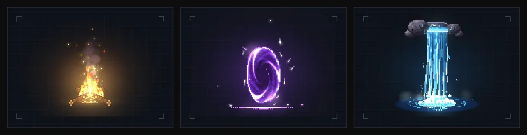

<div align="center">

<p></p>

<p><strong>ピクセルエフェクトを探す、再生する、好きなフレームをPNGに。</strong></p>

[はじめる](#quick-start) · [操作方法](#controls) · [244種類](docs/EFFECT_CATALOG.md) · [開発ガイド](#development)

</div>

<p align="center"></p>

<p align="center"><sub>焚き火 · 魔法のポータル · 滝</sub></p>

## Quick start

Node.js **22.12以降の22系、24系、または26以降**とnpmを用意します。

```bash
git clone https://github.com/taku0193/pixel-fx-studio.git
cd pixel-fx-studio
npm ci
npm run dev
```

**[localhost:5173](http://localhost:5173/)** を開いて、エフェクトを選んでください。

> このリポジトリは非公開です。cloneにはアクセス権のあるGitHubアカウントが必要です。すでに取得済みなら、プロジェクトフォルダで `npm ci` から実行できます。

<details>
<summary>5173が使用中の場合</summary>

```bash
npm run dev -- --host 127.0.0.1 --port 5180
```

[127.0.0.1:5180](http://127.0.0.1:5180/) を開きます。

</details>

## Workflow

1. **選ぶ**。サムネイルから探すか、`雪`、`クラゲ`、`portal` などのキーワードとカテゴリで絞り込みます。名前、ID、説明、タグが検索対象です。
2. **フレームを決める**。再生を一時停止し、コマ送りします。Fitで全体を表示し、2×・4×で拡大したときはドラッグで移動できます。
3. **PNGを書き出す**。再生中でも停止中でも、現在のフレームを元のCanvasサイズで保存できます。

## Controls

| 操作 | ボタン・マウス | キーボード |
| --- | --- | --- |
| エフェクト選択 | サムネイルを選択 | 一覧へTab移動 → 矢印キー |
| 再生 / 一時停止 | **再生する / 一時停止** | `Space` |
| 1コマ進む | **1コマ進む** | `→` |
| 先頭に戻る | **先頭に戻る** | `Home` |
| 表示倍率 | **Fit / 2× / 4×** | ボタンへTab移動 → `Enter` |
| 拡大中の移動 | ステージ上でドラッグ | — |
| Fitに戻す | ステージをダブルクリック | **Fit**へTab移動 → `Enter` |
| PNG保存 | **PNGを書き出す** | ボタンへTab移動 → `Enter` |

再生・コマ送り・先頭へ戻るショートカットは、**プレビューにフォーカスしているとき**に使えます。

<details>
<summary>選択・検索・停止の動作</summary>

- 停止中に別のエフェクトを選んでも、停止状態を維持します。停止時間は再開後の経過時間に加算しません。
- コマ送りは停止して1フレーム進めます。リスタートは再生・停止の状態を保ち、フレーム番号を0に戻します。
- カテゴリや検索を変えて現在の効果が対象外になると、最初の検索結果へ切り替わります。
- 0件の場合は、その前のプレビューを維持します。**絞り込みをリセット**で全244種類に戻せます。
- 検索では大文字・小文字・全角英字を区別しません。空白で区切った語をすべて含む項目を表示します。
- 単発エフェクトは終了後に再生成し、自動で繰り返します。
- PCではギャラリーとプレビューを横に並べ、スマートフォンではプレビューと操作部を先に表示します。

</details>

## Effects

**炎 · 水 · 氷 · 雷 · 爆発 · 魔法 · 回復 · 闇 · 状態異常 · 自然 · 天候 · SF · 剣撃 · 飛び道具 · 衝撃 · 復活 · 連続攻撃 · UI演出 · アイテム · 生き物 · 画面切り替え**

全244種類に日本語名と公式の英語名を併記しています。

**[→ 全244種類の名前・ID・サイズ・再生時間を見る](docs/EFFECT_CATALOG.md)**

| 出力例 | PNGサイズ |
| --- | --- |
| 通常のエフェクト | 320 × 288 px |
| Nuke | 400 × 320 px |
| Rocket launcher | 480 × 288 px |

大型の効果ではCanvasを必要なサイズに拡張し、通常の効果に戻すと320×288に戻します。保存サイズはプレビュー下部に表示します。ファイル名の例は `pixelfx-moves-rocket-launcher.png` です。

連続攻撃12種類は、公式の `createAct` / `actBounds` でキャラクター・予備動作・対象を含めて再生。画面切り替え10種類には公式の星空背景を、それ以外には暗色背景を表示します。

## Development

```bash
npm test                  # Vitest
npm run build             # 型検査 + 本番ビルド → dist/
npm run preview           # ビルドを localhost:4173 で確認
```

**530 tests passing · 6 test files · TypeScript + Vite build verified**<br>
2026-11-11に再実行して確認。Node.js 26.13.0 / npm 11.20.0で開発しています。

<details>
<summary><strong>検証内容と対応状況</strong></summary>

- 全244種類の実描画・時間変化・表示範囲を自動テストで確認。
- 日本語検索、停止・再開・コマ送り・リスタート、ズームの計算、PNG保存を検証。
- 2026-11-10の本番ブラウザ検証で、全244種類・21カテゴリと244枚のサムネイルを確認。
- 全21カテゴリの代表23枚と、新UIの通常・大型・連続攻撃・画面切り替え4枚のPNGを保存・デコードし、Canvasとの一致を確認。
- 幅320〜1440pxの10サイズで、横のはみ出しとキーボード選択を確認。
- Safari / Firefox固有の動作は未検証です。

詳しい結果は [テスト計画](docs/TEST_PLAN.md) と [作業ログ](docs/WORK_LOG.md) に記録しています。

</details>

<details>
<summary><strong>サムネイルを再生成する</strong></summary>

```bash
npm run thumbnails
```

`public/thumbnails/` の244枚は、公式エンジンの代表フレームから生成した240×160 PNGです。実行時は静的画像を遅延読み込みし、プレビュー用のCanvasを増やしません。

この開発用スクリプトにはNode.js **22.18以降の22系、24系、または26以降**を使用してください。ネイティブTypeScript読み込みを使い、外部APIは使用しません。

</details>

<details>
<summary><strong>プロジェクト構成</strong></summary>

```text
src/
  main.ts                 画面と操作
  style.css               スタジオのデザイン
  effects.ts              全244種類・カテゴリ・検索
  effect-names.json       日本語名
  curated-effects.json    初期32種類の順序・日本語説明
  preview.ts              表示範囲と公式プレイヤー
  renderer.ts             単一RAF・再生・停止・コマ送り
  viewport.ts             Fit・倍率・ドラッグ範囲
  export-png.ts           PNG保存とリソース解放
  pixelfx.d.ts             確認済み公開APIの型定義
  __tests__/              6ファイルのテスト
scripts/
  generate-thumbnails.mjs 実描画サムネイルの生成
public/
  thumbnails/             全244種類の画像
  THIRD_PARTY_NOTICES.txt  依存元のライセンスとNOTICE
docs/
  assets/                 README用バナー・エフェクトアニメーション
  EFFECT_CATALOG.md       全エフェクトのカタログ
  MVP_SPEC.md             仕様
  TEST_PLAN.md            テスト計画・検証結果
  WORK_LOG.md             開発記録
vite.config.ts            コア・カテゴリ別のビルド分割
```

ViteとTypeScriptで構成し、pixelfxのエフェクトをCanvas 2Dに描画します。依存取得時にはネットワーク接続が必要です。再生と保存はブラウザ内で完結します。

</details>

## Credits

エフェクトは **[patch-gg/pixelfx](https://github.com/patch-gg/pixelfx)** によるものです。

- pixelfx **0.3.1**、確認済みcommit [`044e12a`](https://github.com/patch-gg/pixelfx/commit/044e12a45dc9cc312cec50ee606dfc98afe5adc2) をHTTPS依存として固定。
- MIT License · Copyright (c) 2026 Patch / Hugo Duprez。一部はSprite FusionやHollow CrownのOSSコード由来です。
- 元のライセンスとNOTICEは [THIRD_PARTY_NOTICES.txt](public/THIRD_PARTY_NOTICES.txt) に同梱し、ビルド時に `dist/` へコピーします。
